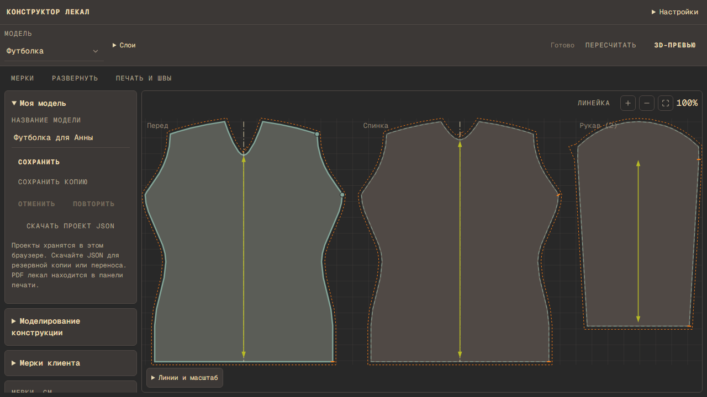

# Shityo

Garment patterns from body measurements: edit a block, check its seams, and print
at full scale. A separate catalog links to 85 verified publisher designs.

[](https://github.com/aa-blinov/shityo/actions/workflows/ci.yml)
[](https://github.com/aa-blinov/shityo/actions/workflows/house-style.yml)
[](LICENSE)

## Quick start

```bash
git clone https://github.com/aa-blinov/shityo.git
cd shityo
python scripts/bootstrap.py
```

Requires Python 3.14, Node.js 24, Git and Docker. Bootstrap creates `.venv`,
installs the locked dependencies and builds the interface. Start the database,
then both local services:

```bash
docker compose up -d mongo
```

```bash
# Linux / macOS
.venv/bin/python scripts/dev.py
# Windows PowerShell
.venv/Scripts/python.exe scripts/dev.py
```

Open [localhost:5173](http://127.0.0.1:5173) and register an atelier: you become its
owner and can add staff. For a demo, `scripts/seed_demo.py --api http://127.0.0.1:8000`
creates a sample atelier with clients, measurement history and orders. Ctrl+C stops the processes started by the launcher. To avoid occupied ports, pass `--api-port 8002 --port 5175`.

## What it does

- Drafts sixteen blocks from measurements: tops, shirt, dress, vest, coat with lapels,
  trousers and skirt with waistbands, knitwear, and lingerie (briefs, boxers, bralette, slip).
- Shows 2D pieces, construction points, seam lengths and an approximate 3D preview.
- Describes every block with a passport (backend/app/blocks) and checks it on the whole
  GOST grid, by its seam pairs and against EMKO SEV typical dimensions (docs/BLOCKS.md).
- Edits pieces point by point: a block can move to the constructor with its edges, seam
  check, darts, folds, per-edge allowances and 3D.
- Keeps an atelier's orders, clients and measurement history in MongoDB, shared by its staff.
- Lists orders by stage and tailor, and clients with their measurement sets side by side.
- Exports SVG, DXF and 1:1 PDF on A4-A0, Letter, Legal or one plotter sheet.
- Includes a 50 mm calibration square, page count, overlap and assembly map.
- Searches 85 external designs from FreeSewing, Mood Sewciety and Tiana's Closet.

External designs open at their publishers. Their geometry is not imported into
our editor. Mood requests a name and email on its own website. Our own
blocks are editable; the external catalog is a verified snapshot, not a live feed.
3D is a visual approximation. Check fit with a physical toile before cutting
finished fabric. Tops take the waist-to-hip length from the client's measurements.

## Screenshots



The editor supports desktop, laptop and tablet workspaces. Phone panels open
over the drawing. See [the screenshot index](docs/screenshots/README.md).

## Configuration

| Variable | Default | Used by |
| --- | --- | --- |
| PORT | 5173 | Production UI server |
| HOST | 127.0.0.1 | Production UI server |
| BACKEND_ORIGIN | http://127.0.0.1:8000 | UI proxy and server-side API requests |
| CORS_ORIGINS | Local development origins | FastAPI, comma-separated |
| PUBLIC_API_BASE | Same-origin /api in the browser | Optional explicit public API URL |
| TEST_API_PORT / TEST_UI_PORT | 8000 / 5173 | Browser tests |
| TEST_REUSE_SERVERS | true | Set false to require isolated test servers |
| MONGO_URL | mongodb://127.0.0.1:27017 | FastAPI storage |
| MONGO_DB | shityo | FastAPI storage; tests use their own databases |
| COOKIE_SECURE | unset | Set 1 behind HTTPS so the session cookie is Secure-only |
| TEST_MONGO_DB | shityo_e2e_<time> | Browser tests database |

The server reads process environment variables. `.env.example` documents the
names; it is not loaded automatically. No API key is required to draft or print.
Ateliers, staff, clients, measurement sets, orders and their version history live
in MongoDB; attached PDF, SVG and DXF files live in GridFS. The compose file binds
the database to 127.0.0.1 without a password: add authentication before exposing
it. Data saved by earlier versions in browser storage is offered for transfer
after the first sign-in. The atelier page downloads a full JSON backup.

## How it works

FastAPI builds geometry in millimetres and validates contours before export.
SvelteKit renders the same piece data, while a Node server proxies browser API
requests. The UI uses a pinned Monos UI commit. Python and npm dependencies are
locked; the project follows golden-repo v1.0.11.

Read [the architecture](docs/ARCHITECTURE.md), [API](docs/API.md),
[printing review](docs/PRINT-REVIEW.md) and [source provenance](docs/PATTERN-LIBRARY.md).

## Development

```bash
.venv/bin/python -m pytest
.venv/bin/python -m ruff check backend scripts frontend/scripts
.venv/bin/python -m ruff format --check backend scripts frontend/scripts
npm run check --prefix frontend
npm run check:i18n --prefix frontend
npm run build --prefix frontend
npm test --prefix e2e
npm run test:cloth --prefix e2e
python scripts/housecheck.py --strict .
```

On Windows replace `.venv/bin/python` with `.venv/Scripts/python.exe`. Install
Chromium once with `cd e2e` then `npx playwright install chromium`. Tests start a
real backend and built UI; CI uses deterministic image responses for publisher
thumbnails, while the checked-in catalog retains the original source addresses.

[Contributing](CONTRIBUTING.md) explains the workflow. [Documentation](docs/README.md)
indexes the guides. Dependency refresh commands are in [development](docs/development.md).

## License

Project code: [MIT](LICENSE), copyright Alexander Blinov.
[Third-party notices](docs/third-party.md) cover Monos UI, the embedded font,
FreeSewing metadata and publisher images. External pattern and image rights stay
with their authors; this repository does not grant rights to those materials.
