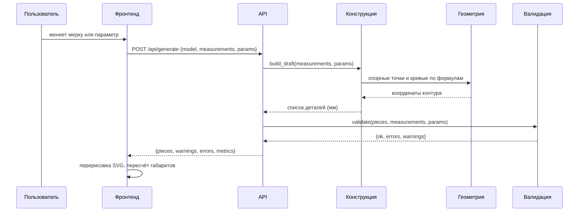
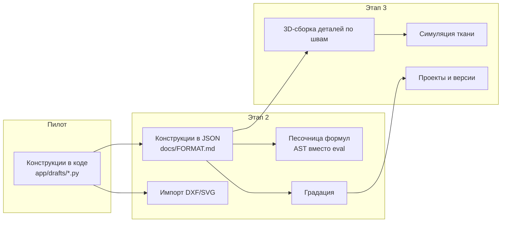

# Архитектура

## Компоненты

```mermaid
flowchart TB
    subgraph client["Браузер (SvelteKit 5)"]
        UI["Рабочая область<br/>мерки, параметры, слои"]
        CANVAS["2D-холст<br/>SVG, мм"]
        PREVIEW["3D-превью<br/>three.js, геометрия"]
        STORE["Состояние<br/>руны Svelte 5"]
    end

    subgraph backend["FastAPI"]
        ROUTES["/api/catalog<br/>/api/generate<br/>/api/validate<br/>/api/validate/sizes<br/>/api/export/*"]
        DRAFTS["Параметрические конструкции<br/>app/drafts/*"]
        GEOM["Геометрическое ядро<br/>app/core/geometry.py"]
        VALID["Валидация<br/>app/core/validation.py"]
        EXPORT["Экспорт<br/>SVG / DXF / PDF"]
        SIZES["Размерные сетки<br/>app/core/sizes.py"]
    end

    UI --> STORE
    STORE -->|"POST /api/generate"| ROUTES
    STORE -->|"GET /api/catalog"| ROUTES
    CANVAS <-|"outline, notches, grainline"| STORE
    PREVIEW <- STORE
    ROUTES --> DRAFTS
    ROUTES --> SIZES
    DRAFTS --> GEOM
    ROUTES --> VALID
    ROUTES --> EXPORT
    EXPORT --> GEOM
```

## Поток данных одной генерации



## Границы модулей

| Модуль | Что отвечает | Что не делает |
|---|---|---|
| `app/core/geometry.py` | Точки, кривые, контуры, смещение | Не знает про одежду и мерки |
| `app/drafts/*` | Формулы построения конкретных изделий | Не знает про HTTP и файлы |
| `app/core/validation.py` | Проверка готового лекала | Не строит и не правит |
| `app/export/*` | Запись лекала в SVG/DXF/PDF | Не считает геометрию заново |
| `app/api/*` | HTTP-контракт | Не содержит правил конструирования |
| `frontend/` | Ввод, просмотр, экспорт | Не считает геометрию лекал |

## Почему так разделено

Геометрия деталей - это то, что должно совпадать у всех потребителей:
API, экспорт и 2D-просмотр берут одни и те же координаты из одного
источника. Если бы фронтенд считал геометрию сам, расхождение между тем,
что на экране, и тем, что в PDF, было бы вопросом времени.

Конструкции отделены от движка: добавление новой модели - это новый файл в
`app/drafts/` плюс запись в каталоге, а не правка геометрии.

## Почему не микросервисы

В пилоте один процесс. Причины: критический путь (мерки -> чертёж -> печать)
не должен пересекать сетевые границы; отладка должна быть одной командой;
задержка и отказоустойчивость сети не являются предметом пилота.

Что будет отдельным сервисом, когда вырастет нагрузка: выгрузка PDF и
раскладка деталей (тяжёлые операции, удобно отдавать в очередь). Контракт
при этом не меняется - меняется только то, куда уходит вызов.

## Развитие системы



Переход от кода к JSON - отдельный этап именно потому, что до него
конструкции проверяются тестами по поведению, а не по содержимому файла.
После перехода появляется эталонная точка: JSON-модель можно хранить,
сравнивать и править без программиста.
